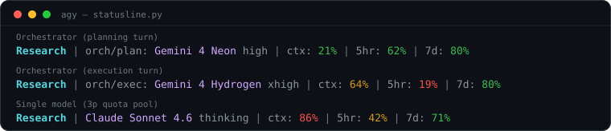

# agy-statusline

Single-line, zero-dependency Python statusline script for the Google Antigravity CLI (`agy`).



## Design & Colors

The statusline renders five pipe-separated segments on a single line:

```text
<dir> | [orch/<role>: ]<model>[ <effort>] | ctx: <used%> | 5hr: <rem%> | 7d: <rem%>
```

| Segment | Meaning | ANSI Style / Thresholds |
| :--- | :--- | :--- |
| `<dir>` | Current project directory (`~` for `$HOME`, `?` if missing) | Bold Cyan (`\033[1;36m`) |
| ` \| ` | Segment separator | Dim (`\033[2m`) |
| `orch/plan:` / `orch/exec:` / `orch:` | Active Orchestrator phase prefix (omitted for single models) | Dim (`\033[2m`) |
| `<model>` | Active model display name | Magenta (`\033[35m`) |
| `<effort>` | Reasoning effort (e.g. `high`, `xhigh`, `thinking`) | Dim (`\033[2m`) |
| `ctx:`, `5hr:`, `7d:`, `--` | Metric labels and unavailable fallback | Dim (`\033[2m`) |
| `ctx:` value (used %) | Context window utilization | `< 50%` Green (`\033[32m`), `50–79%` Yellow (`\033[33m`), `≥ 80%` Red (`\033[31m`) |
| `5hr:` & `7d:` values (remaining %) | Rolling 5-hour and 7-day quota remaining | `> 50%` Green (`\033[32m`), `21–50%` Yellow (`\033[33m`), `≤ 20%` Red (`\033[31m`) |

## Features

- **Live Orchestrator model tracking:** Displays `orch/plan: <planner>` during planning/Q&A turns and `orch/exec: <executor>` during execution turns by reading the active session `transcript.jsonl` (supporting both `~/.gemini/antigravity-cli/brain/` and `~/.gemini/antigravity/brain/`).
- **Automatic quota pool selection:** Maps Gemini/Orchestrator models to `gemini-*` buckets and third-party models (`claude`, `sonnet`, `opus`, `haiku`, `gpt`, `openai`, `o1`/`o3`/`o4`, `codex`) to `3p-*` buckets, dynamically following the active Orchestrator sub-model.
- **Zero external dependencies:** Uses only the Python standard library.

## Requirements

- Python 3.10+

## Setup

1. Copy `statusline.py` to your config directory and make it executable:

   ```bash
   mkdir -p ~/.config/agy
   cp statusline.py ~/.config/agy/statusline.py
   chmod +x ~/.config/agy/statusline.py
   ```

2. Add the `statusLine` block to `~/.gemini/antigravity-cli/settings.json`:

   ```json
   {
     "statusLine": {
       "type": "command",
       "command": "~/.config/agy/statusline.py"
     }
   }
   ```

   Or configure it interactively from inside `agy`:

   ```text
   /statusline ~/.config/agy/statusline.py
   ```

## Test Locally

```bash
printf '{"model":{"display_name":"Orchestrator (Neon)"},"workspace":{"current_dir":"/tmp/Research"},"context_window":{"used_percentage":21},"quota":{"gemini-5h":{"remaining_fraction":0.62},"gemini-weekly":{"remaining_fraction":0.80}}}' | ~/.config/agy/statusline.py
```
